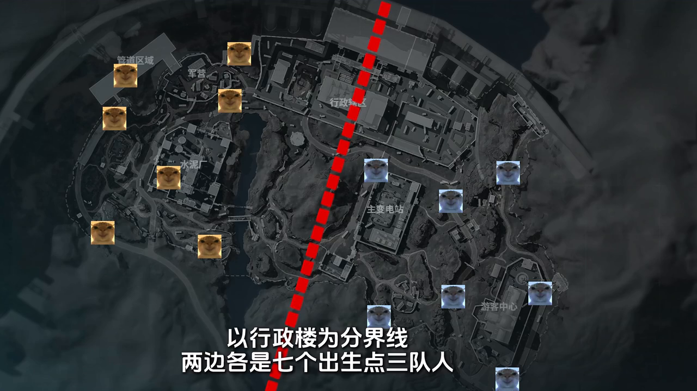
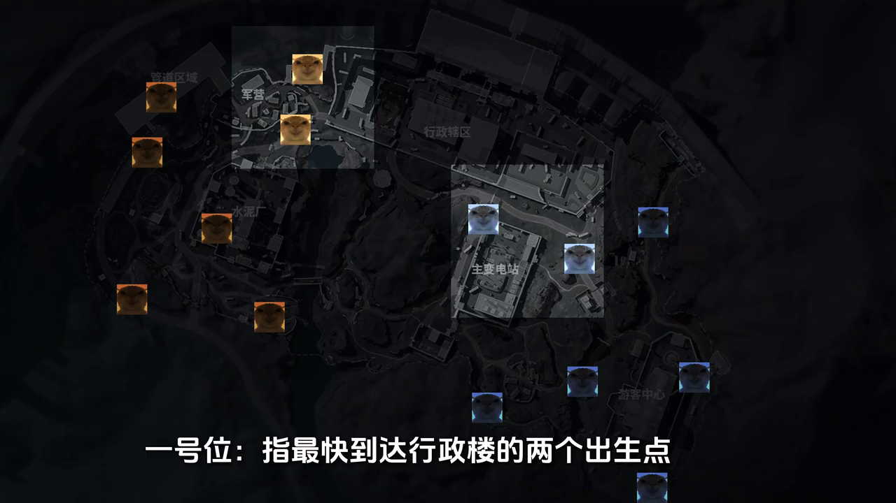
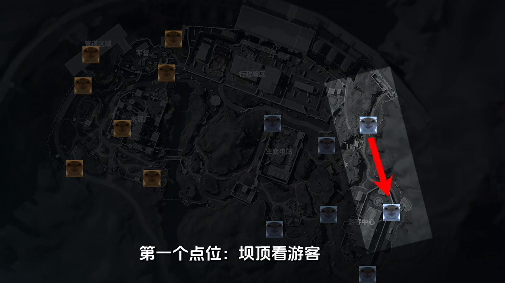
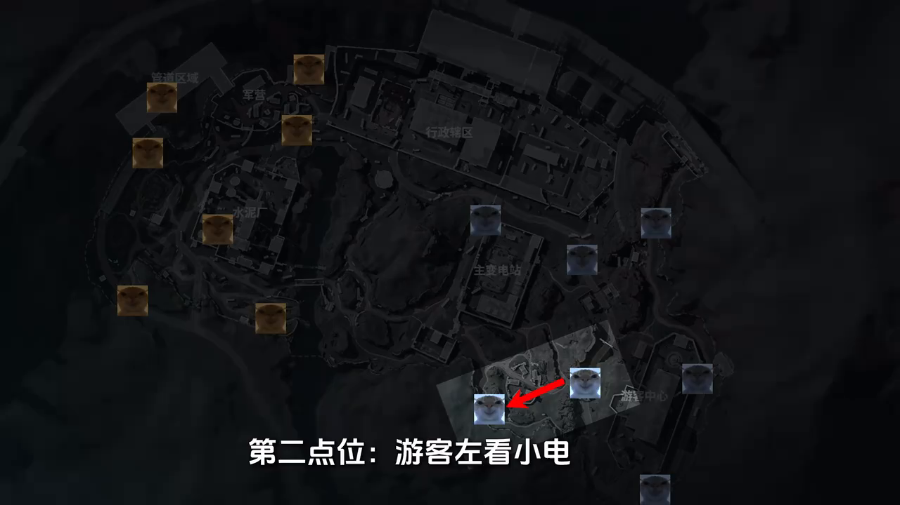
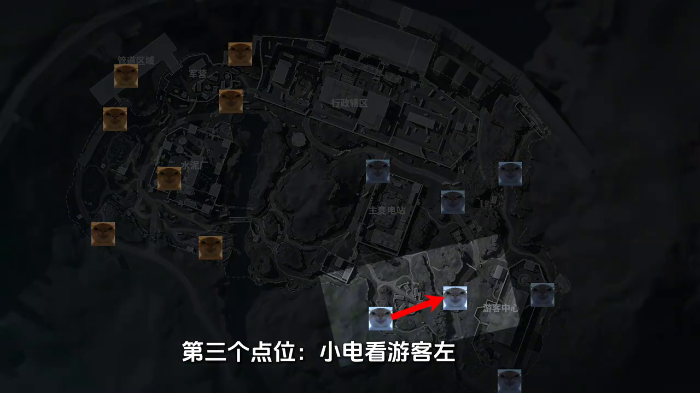
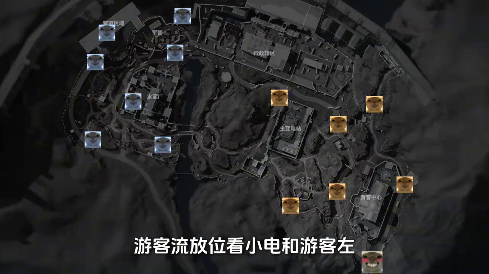
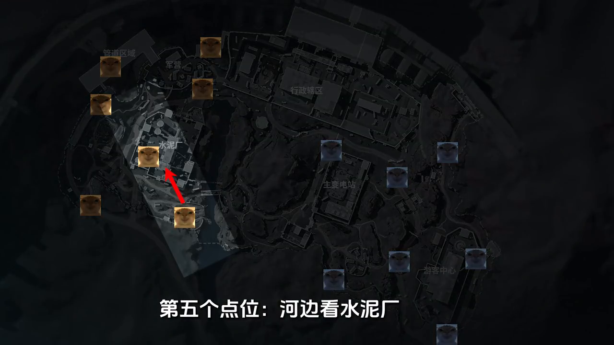

# 零號大壩

## 基礎觀念（機密：出生點與開局資訊）

> 以下整理自「不散兒」的機密大壩影片，重點是**五個出生點的觀察與避戰思路**，不是所有出生點的完整打法。出生規則、AI 和地圖可能隨版本調整；以下是影片中的經驗判斷，實戰仍要確認腳步與槍聲。

* 大地圖與出生點劃分：影片以行政樓為界，東、西兩側各有 `7 個出生點`、各 `3 隊`，合計 `14 個出生點、6 隊`。影片中的一般撤離方向是從出生側往對側走，實際仍以當局撤離點為準。

    

* 一號位：影片將各側**最快到行政樓的兩個候選出生點**稱為一號位；依影片說法，各側這兩點中固定刷一隊。圖中亮起的兩組分別是西樓與東樓一號位。

    

* **拿資訊思路**：如果自己不是一號位，先把自己與同側一號位各算一隊，再觀察剩下那隊可能在哪；自己是一號位時，不能套用「一號位加自己是兩隊」的算法。
* 下方圖片中的紅箭頭表示影片示範的**觀察方向**，不是敵人一定存在或一定會走的路線。

### 東邊分析

#### 1. 壩頂看遊客中心（[00:36](https://www.bilibili.com/video/BV1KCuEzuEbj/?t=36)）

* 出生後 `切刀快跑、稍微偏右前方`，看遊客中心方向；影片示範這裡不帶高倍鏡也能看見人影。
* **看到遊客中心有人**：先掌握對方資訊；若一號位沒有轉去變電站，可考慮先搜變電站。
* **沒看到人**：先搜附近物資並聽聲音。遊客方向響槍時，可繼續往變電站；沒有槍聲再謹慎查看遊客中心。
* 額外線索：影片提到盾兵正常巡邏時，遊客中心可能沒人；盾兵舉盾警戒時，裡面可能有人。這只能當線索，靜步玩家或晚到的隊伍仍可能存在。

#### 2. 遊客左看小電（[01:33](https://www.bilibili.com/video/BV1KCuEzuEbj/?t=93)）

* 出生後切刀往小電方向跑，觀察營地是否刷新 AI。
* **看到營地 AI 刷新**：影片用來推測小電沒有出生隊伍；若東樓一號位也沒有轉往變電站，可以考慮先搜變電站。
* **到影片示範的觀察位置仍沒看到 AI**：小電可能有人，建議回頭搜遊客中心，不要直接衝進營地。

#### 3. 小電看遊客左（[01:59](https://www.bilibili.com/video/BV1KCuEzuEbj/?t=119)）

* 出生後切刀跑到影片示範的岩石觀察位；跳上岩石前靠右避開小石頭，避免卡腳。
* 建議帶 `高倍鏡`，跳上後邊開鏡邊向左移，透過樹木縫隙觀察遊客左。
* **沒看到人**：影片推測另一隊可能在遊客中心或壩頂，建議先搜小電，減少與對面快速撤離隊伍搶物資的機會，同時留意一號位轉向。

#### 4. 遊客流放位看小電與遊客左（[02:27](https://www.bilibili.com/video/BV1KCuEzuEbj/?t=147)）

* 出生後切刀沿影片路線跑向遊客左出生點，途中偶爾遇到的小兵可先清掉。
* 抵達觀察位置時，**看到營地小兵剛刷新**：影片推測小電與遊客左都沒有出生隊伍。
* **沒有看到小兵刷新**：影片判斷這兩個出生點可能有人，建議回頭搜遊客中心。
* 影片的解釋是：玩家出生或移動會影響小兵刷新與巡邏時機，因此要看「跑到指定位置時是否剛刷新」，不是單純把「沒看到 AI」視為絕對有人。

### 西邊分析

#### 5. 河邊看水泥廠（[04:54](https://www.bilibili.com/video/BV1KCuEzuEbj/?t=294)）

* 出生後先看兩個管道附近的露天刷新點，再搜下方管道，之後觀察水泥廠內的火箭兵。
* **火箭兵有刷新**：影片推測水泥廠一號位沒人，可視情況進廠。
* **火箭兵沒刷新**：影片推測水泥廠內有出生隊伍；可改搜河邊物資箱，再轉地下。
* 即使廠內出生點沒人，`水泥管道與西南方向`的隊伍仍可能進廠；注意槍聲，保留撤退路線。

### 補充：水泥管道架嶺南（[03:48](https://www.bilibili.com/video/BV1KCuEzuEbj/?t=228)）

* 影片示範三種觀察方式：快速攀爬至高處架槍、高倍鏡遠距拿資訊，以及較保守、不需高倍鏡的觀察路線。
* 高處攀爬需靠近障礙物，先按空白鍵再按 `W`；攀爬時連按兩次空白鍵。路線與落腳位置請對照影片練習，避免衝刺跳歪。

### 參考資料

* [【三角洲行动】机密大坝鼠鼠开局知道敌人位置-带地图 — 不散儿](https://www.bilibili.com/video/BV1KCuEzuEbj/)。文中地圖圖片擷取自該影片。

## 💡 實戰心得

### 個人心得

* N/A

---
## 🔗 相關連結

* [⬅️ 返回三角洲首頁](../delta-force.md)
